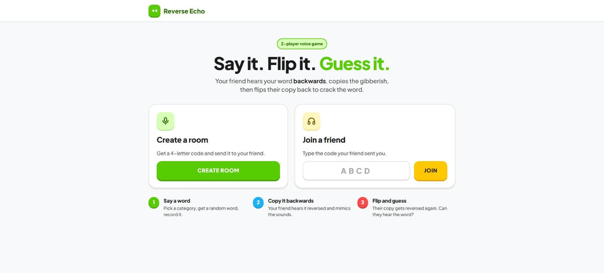
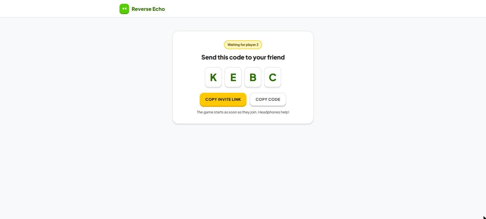
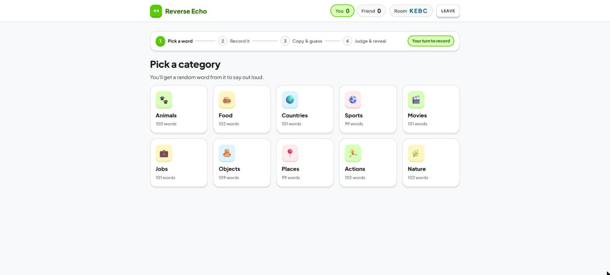
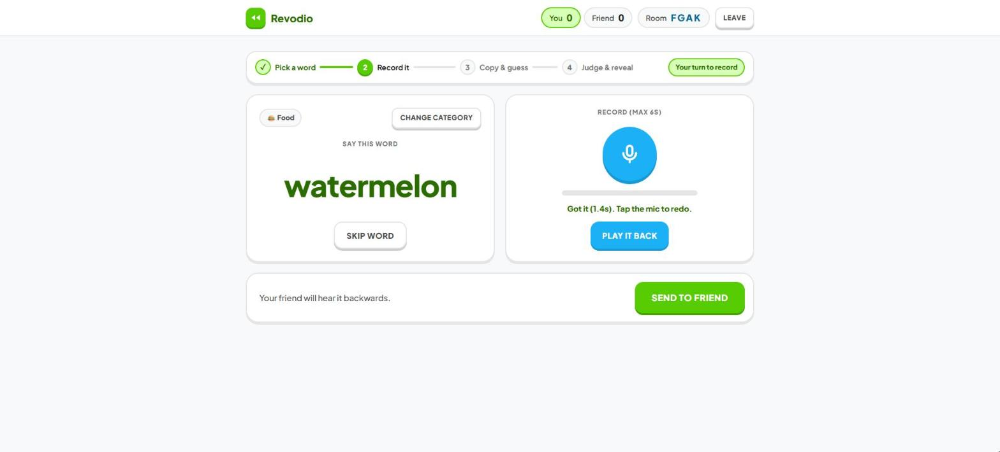
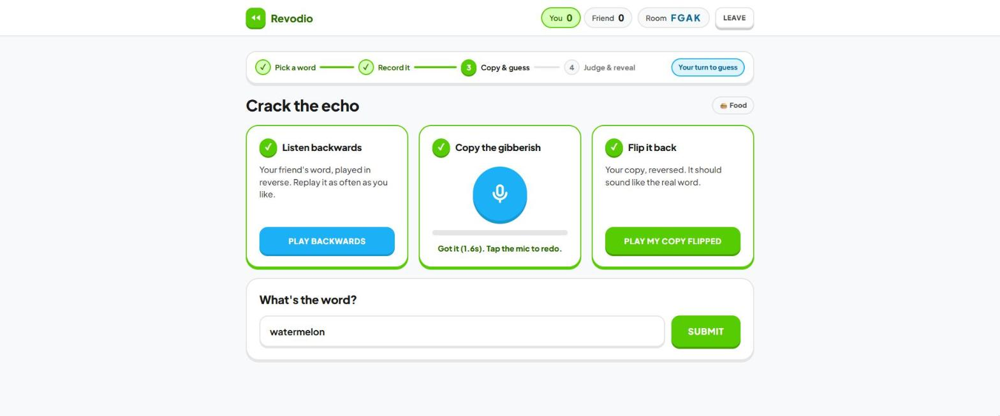
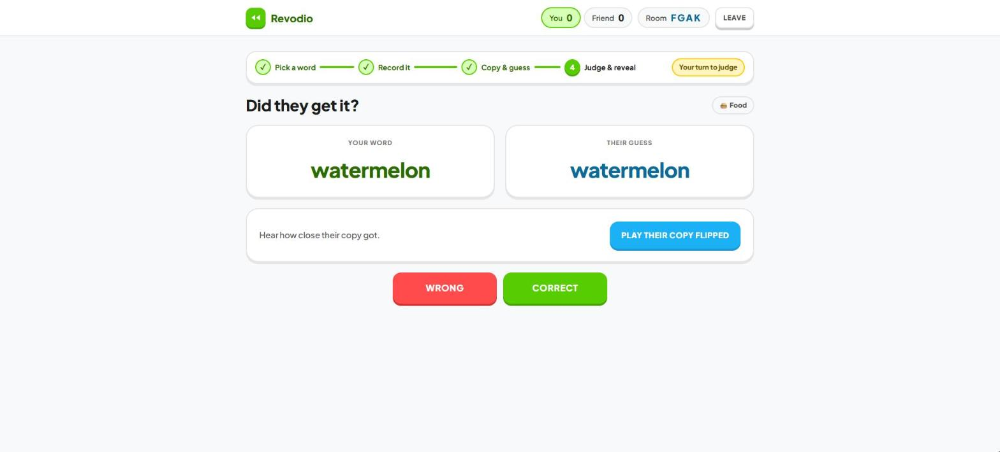
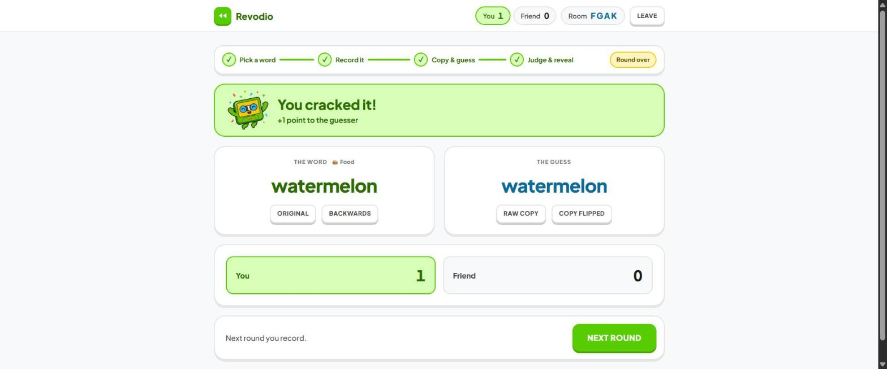

# REVODIO

**Say it. Flip it. Guess it.**
A 2-player voice game in the browser. Your friend hears your word **backwards**, copies the gibberish, then flips their copy back to crack the word.

**▶ Play now: [revodio.onrender.com](https://revodio.onrender.com)**



---

## How to play

1. **Create a room** and send the 4-letter code (or invite link) to a friend on another device.
2. **The recorder** picks one of 10 categories, gets a random word and records themselves saying it.
3. **The guesser** hears it reversed, records themselves copying the backwards sounds, then plays their copy reversed again. It should sound roughly like the real word. They type a guess.
4. **The recorder judges** the guess: Correct or Wrong. A correct guess gives the guesser 1 point.
5. Roles swap and the next round starts.

## Screenshots

| Waiting for player 2 | Pick a category |
|---|---|
|  |  |

| Record the word | Copy & guess |
|---|---|
|  |  |

| Judge the guess | Reveal & score |
|---|---|
|  |  |

## Features

- **Real-time rooms** with 4-letter codes and invite links (`/?room=ABCD` joins straight away)
- **10 categories, ~1,000 words**: Animals, Food, Countries, Sports, Movies, Jobs, Objects, Places, Actions, Nature
- **Audio reversal in the browser** using the Web Audio API. No audio processing on the server.
- **Cross-browser audio**: each player decodes their own recording and sends raw samples, so Chrome, Safari and Firefox can all play each other's clips.
- **Fair play**: the guesser only receives the word after the verdict.
- **Responsive**: designed laptop-first, works on tablets and phones.

## Tech stack

| Part | Tech |
|---|---|
| Server | Node.js, Express, Socket.IO (rooms held in memory, no database) |
| Client | Plain HTML, CSS and JavaScript (no build step) |
| Audio | `MediaRecorder` to record, Web Audio API to decode, reverse and play |

## Project structure

```
server.js           Express + Socket.IO server: rooms and message relay
public/index.html   All game screens
public/style.css    Flat, tactile game UI (no gradients)
public/app.js       Game flow, recording, reversing, playback
public/words.js     Word lists per category (add words here)
test.js             Server self-check
```

## Run locally

Requires Node.js 18 or newer.

```bash
npm install
npm start
```

Open http://localhost:3000 in two browser windows side by side (not two tabs: browsers pause audio in hidden tabs).

```bash
npm test
```

> Browsers only allow the microphone on `localhost` or HTTPS. To play on phones, use the deployed (HTTPS) version.

## Deploy (Render, free)

1. On [render.com](https://render.com), create a **New → Web Service** and connect this repository.
2. Build command: `npm install`. Start command: `npm start`. Instance type: **Free**.
3. Deploy and share the `https://….onrender.com` link.

The live site deploys automatically: every push to `main` triggers a new Render deploy.

Free Render apps sleep when idle, so the first visit can take about 50 seconds to wake up.

## Adding words

Open `public/words.js` and add comma-separated words to any category. The category cards show the new counts automatically.
